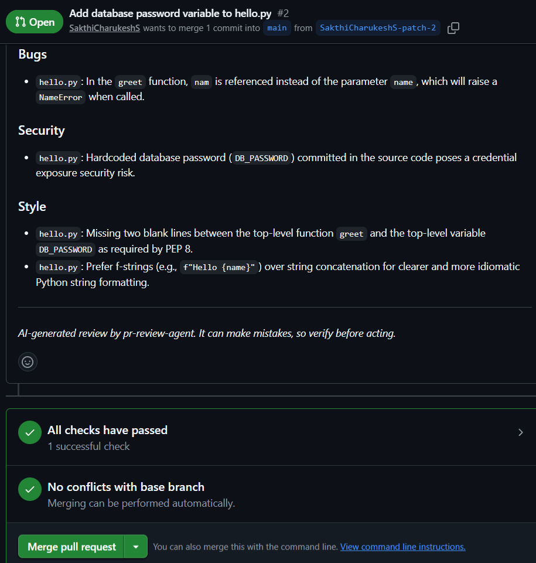
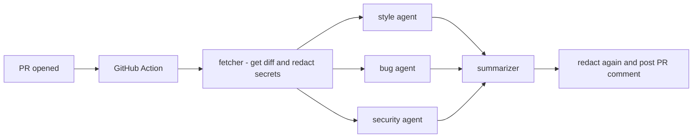

# pr-review-agent

An AI code reviewer for GitHub pull requests, built with **Google ADK** and Gemini.
When a PR is opened, three specialist agents review it in parallel (bugs, security, style),
a summarizer merges their findings, and the review is posted as a PR comment.




## How it works



- **fetcher**: an ADK agent with one tool that downloads the PR diff from the GitHub API
  and saves it in session state. Secrets in the diff are masked before any AI sees them.
- **style / bug / security agents**: run at the same time (`ParallelAgent`), each with one
  narrow job. They read the diff from state and save their findings with `output_key`.
- **summarizer**: merges the three reviews into one grouped comment.
- **guard**: a `before_agent_callback` that skips the reviewers when no diff was fetched
  (for example a wrong PR number), so the pipeline never crashes on bad input.
- **reliability**: request timeouts and patient retries that wait out Gemini rate limits.
- **safety**: secret values are masked in the diff and again in the final review.

## Use it on your own repositories (GitHub Action)

You need two things in each repository: a secret and a workflow file.

1. Create a Gemini API key in [Google AI Studio](https://aistudio.google.com).
2. In your repo: **Settings, Secrets and variables, Actions, New repository secret**.
   Name it `GOOGLE_API_KEY` and paste the key.
3. Add `.github/workflows/pr-review.yml`:

```yaml
name: AI PR Review

on:
  pull_request:
    types: [opened, ready_for_review]

permissions:
  contents: read
  pull-requests: write

jobs:
  review:
    # Skip drafts and PRs from forks (forks can't read repo secrets)
    if: >-
      github.event.pull_request.draft == false &&
      github.event.pull_request.head.repo.full_name == github.repository
    runs-on: ubuntu-latest
    timeout-minutes: 10
    steps:
      - uses: SakthiCharukeshS/pr-review-agent@v1
        with:
          google_api_key: ${{ secrets.GOOGLE_API_KEY }}
```

Open a pull request. A check named **AI PR Review** appears, and a few minutes later a comment
from `github-actions[bot]` with the review. The GitHub token is provided automatically by
GitHub Actions, so you only create the Gemini key.

**Want a different Gemini model?** Fork this repo, change the `MODEL` line in
`my_agent/agent.py`, and use `uses: YOUR-USERNAME/pr-review-agent@main` in your workflow.

## Run it locally

```
git clone https://github.com/SakthiCharukeshS/pr-review-agent
cd pr-review-agent
python -m venv venv
venv\Scripts\activate          # macOS/Linux: source venv/bin/activate
pip install -r requirements.txt
```

Create `my_agent/.env` (see `my_agent/.env.example`) with your keys, then:

```
python review.py owner/repo 12 --dry-run    # print the review only
python review.py owner/repo 12              # review and post the comment
adk web                                     # ADK's browser UI, for debugging
```

For local runs, `GITHUB_TOKEN` must be a fine-grained token limited to your repos with
**Pull requests: Read and write** (and **Contents: Read** for private repos).

## Configuration

| Setting | Where | Notes |
|---|---|---|
| `GOOGLE_API_KEY` | repo secret, or `my_agent/.env` locally | Your Gemini key |
| `GITHUB_TOKEN` | automatic in Actions, `my_agent/.env` locally | Needs `pull-requests: write` |
| `MODEL` | `my_agent/agent.py` | Currently `gemini-3.6-flash` |
| Diff size cap | `my_agent/agent.py` | 20,000 characters |

## Limits (read this before using it)

- **Free-tier quota.** One review makes about 6 Gemini requests. On the free tier
  `gemini-3.6-flash` allowed 5 requests per minute when this was written, so a review can
  take a few minutes while it waits and retries. Limits also apply per day and differ per model.
- **Reviews run on open only.** Not on every pushed commit, to save quota. Drafts are skipped.
- **Fork PRs are skipped.** GitHub does not give secrets to workflows triggered from forks.
- **Large PRs.** Only the first 20,000 characters of a diff are reviewed.
- **Secret masking is pattern-based.** It catches common formats (assignments like
  `password = "..."`, GitHub, Google and AWS keys, private key blocks), but it is a safety
  net, not a guarantee.
- **AI makes mistakes.** Style nitpicks in particular can be wrong. Treat it as a first pass.
- **Model names change.** Last verified October 2026 with ADK 2.11.0. If Google retires a
  model, change the one `MODEL` line.

## Troubleshooting

| Symptom | Cause and fix |
|---|---|
| `429 RESOURCE_EXHAUSTED` | Free-tier limit reached. Wait a minute (or until tomorrow for daily limits), pick another model, or enable billing. |
| `503 UNAVAILABLE` | Gemini is overloaded. Retry later. |
| `404` when fetching the PR | Wrong repo or PR number, or the token lacks access. GitHub answers `404` for private repos you can't read. |
| `No review produced` | The diff fetch failed. The message printed next to it explains why. |
| `Unable to resolve action` | The action repo must be public, or shared via Settings, Actions, General, Access. |
| No check appears on the PR | The workflow file must be on the default branch before the PR is opened. |

## Project layout

```
pr-review-agent/
├── action.yml              reusable GitHub Action
├── review.py               CLI: run the pipeline on one PR
├── my_agent/
│   ├── agent.py            ADK agents, tool and guard
│   ├── github_client.py    posts the PR comment (plain Python, no AI)
│   └── redact.py           secret masking
├── tests/                  unit tests (no network, no Gemini calls)
├── .github/workflows/      ci.yml (tests), pr-review.yml (reviews this repo's PRs)
├── requirements.txt        pinned runtime dependencies
└── requirements-dev.txt    adds pytest
```

## Development

```
pip install -r requirements-dev.txt
python -m pytest -v
```

The tests use a fake model and a fake GitHub, so they need no keys and use no quota.

## Roadmap

- Fetch the diff in plain Python instead of through an AI agent (4 requests per review instead of 6)
- Optional label-gated reviews for PRs from forks
- Move from `SequentialAgent`/`ParallelAgent` to ADK 2.0 `Workflow` (the old classes are deprecated)
- An eval set to measure review quality

## Built with

Google ADK 2.11 (`LlmAgent`, `ParallelAgent`, `SequentialAgent`, session state, callbacks, `Runner`),
Gemini, GitHub Actions, pytest.

## License

MIT, see [LICENSE](LICENSE).